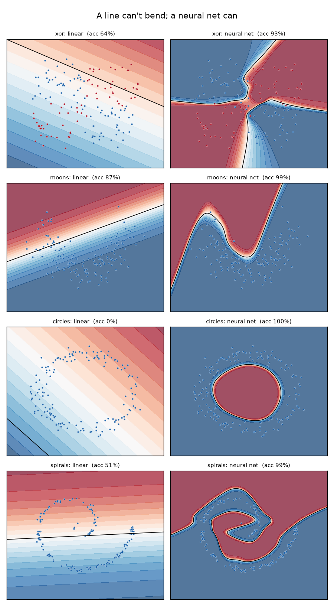
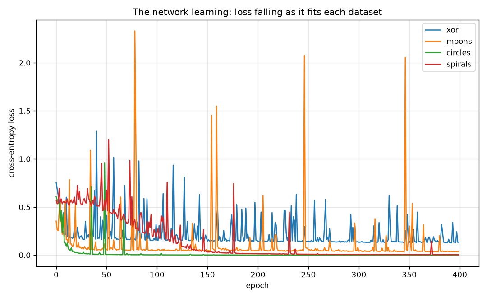

# Neural Net — built from scratch, and gradient-checked

A neural network is less mysterious than it looks: a stack of matrix multiplies,
a squashing function between them, and the chain rule to figure out which way to
nudge every weight. This project builds a multilayer perceptron with **no framework
at all** — the forward pass, the backward pass (backprop), and the training loop are
all hand-written numpy — then does the two things that actually matter: *proves the
math is right*, and shows *when the extra power is worth it*.

## First, prove it's correct

Backprop is easy to get subtly wrong, and a wrong gradient still "trains" — just
toward the wrong place. So before trusting a single result, the hand-derived
gradients are checked against **numerical** ones: nudge each weight by a hair, watch
how the loss moves, and confirm the finite-difference slope matches what backprop
claims.

```
Gradient check: max relative error = 2.0e-07  (PASS -- backprop is correct)
```

An error around `1e-7` means the analytic gradients are right to machine precision.
That check is the first test in the suite, because everything else is meaningless if
the gradients are wrong.

## Then, show when it's worth it

The honest question about any fancy model is *compared to what?* Here the baseline is
a linear model — which is just this same network with **zero hidden layers** (that's
exactly logistic/softmax regression). Both are trained on four 2-D problems, each
built so that no straight line can separate the classes:

```
dataset      linear   neural net
xor             64%          93%
moons           87%          99%
circles          0%         100%
spirals         51%          99%
```



The pictures say it best. The linear model can only ever draw a **straight** boundary,
so on every one of these it fails — splitting a spiral or a ring with a line is
hopeless. The neural net bends its boundary into an X, an S, a closed loop, a
double-spiral, and separates what the line couldn't. *That* is what hidden layers buy:
the ability to represent nonlinear functions.



The loss curve is the network actually learning — cross-entropy falling epoch by
epoch as gradient descent finds weights that fit each shape.

## Install & run

```bash
pip install -r requirements.txt
python -m neural_net                  # gradient check, accuracy table, charts
python -m neural_net --epochs 800
```

## Reading the result honestly

- **The nonlinearity is only worth it when the problem is nonlinear.** On data a line
  *can* separate, the neural net wins nothing — it just adds parameters, tuning, and
  chances to overfit. The headline "+47% accuracy" is specific to problems chosen to
  be hard for a line; it is not a general claim that neural nets beat linear models.
- **These are tiny, clean, 2-D toys.** They isolate one idea — nonlinear decision
  boundaries — on purpose. Real problems bring high dimensions, messy labels, and far
  more data, where regularization, architecture, and optimization all start to matter.
- **"From scratch" is for understanding, not production.** This is ~120 lines of numpy
  to make backprop concrete. For real work you'd use a framework (PyTorch, JAX) with
  autograd, GPUs, and battle-tested optimizers — but you'd trust it more having once
  written the gradients yourself.

## What's inside

- `nn.py` — the `MLP`: forward pass, hand-derived backprop (`gradients`), and
  minibatch-SGD training. Zero hidden layers gives logistic regression.
- `gradcheck.py` — numerical vs. analytic gradient comparison (the correctness proof)
- `datasets.py` — XOR, moons, circles, and spirals: 2-D problems no line can solve
- `experiment.py` — train a linear model and the net on each, report accuracy
- `plots.py` — the decision-boundary grid and the training-loss curve
- `cli.py` — the command-line entry point

## Tests

```bash
python -m pytest
```

All 10 tests run offline and deterministically. The first and most important checks
that analytic gradients match numerical gradients to under `1e-5` on two different
architectures — if that passes, backprop is correct. The rest confirm the pieces
(softmax is a distribution, shapes line up), that training drives the loss down and
solves XOR, that the net beats the linear baseline on nonlinear data, and that a
zero-hidden-layer network still aces a linearly separable problem.
